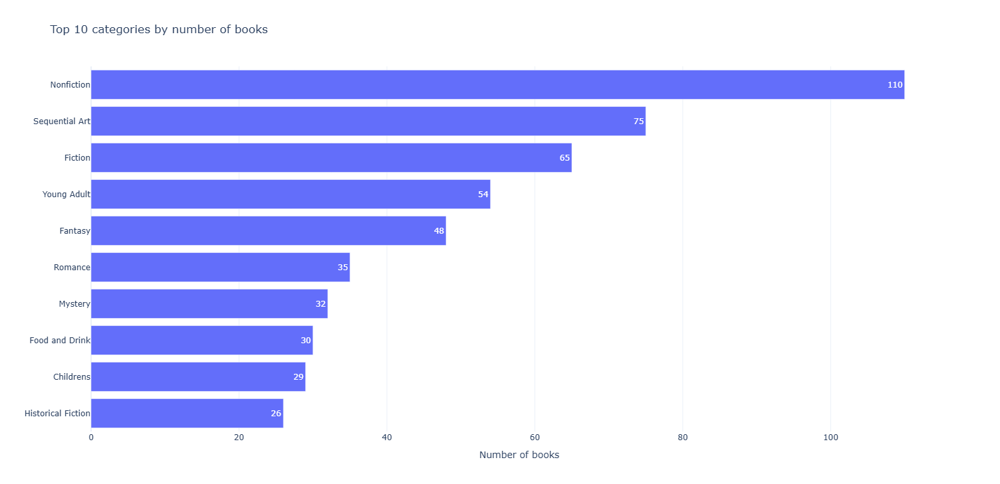
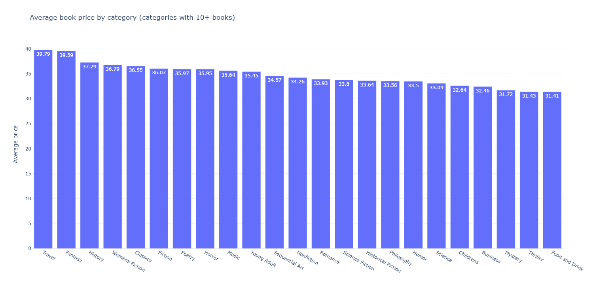
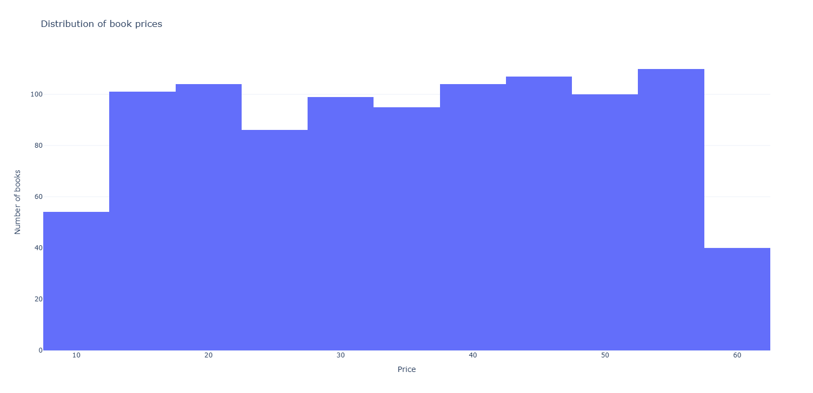
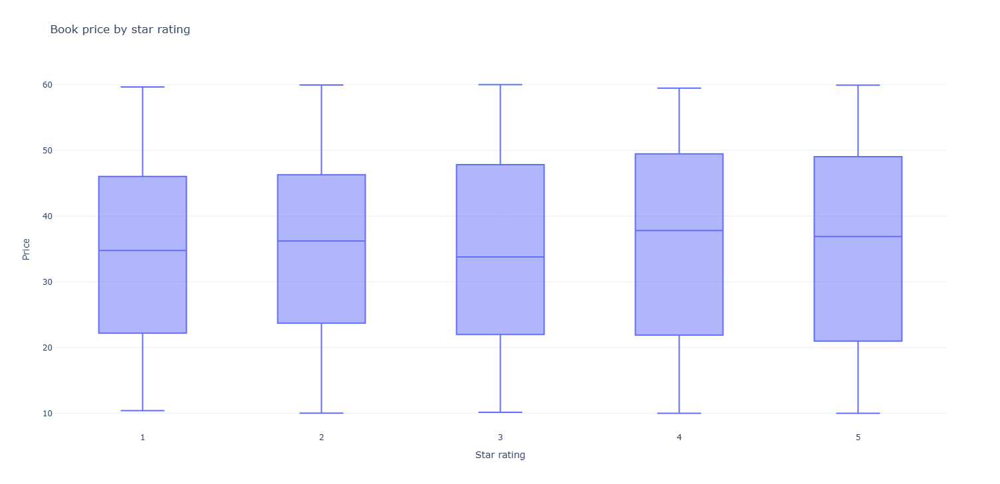
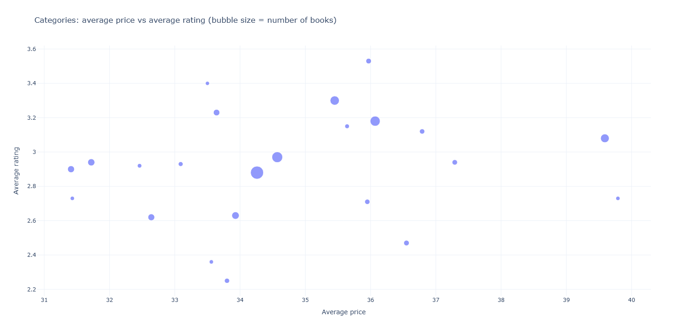
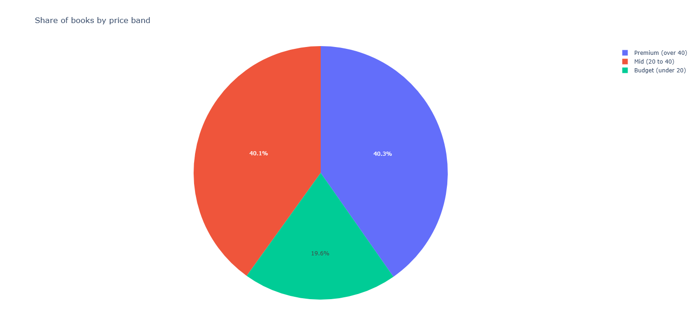

# Book Market Analysis: Web Scraping, Cleaning and Plotly

Scraped 1,000 books across 50 categories from books.toscrape.com (a practice site that allows scraping) using Selenium and BeautifulSoup. Cleaned the data with pandas, answered business questions with groupby, correlation and a t-test, and visualised the results with Plotly Express.

**Tools:** Python, Selenium, BeautifulSoup, pandas, Plotly Express, SciPy

## Key findings
- Nonfiction is the largest category with 110 books (14.1% of the 781 books in real categories).
- Average prices range only from £31.41 (Food and Drink) to £39.79 (Travel).
- Price and rating are unrelated: correlation 0.028; a t-test of 5-star vs 1-2 star books found no significant difference (p = 0.582).
- 40.3% of books are over £40, 40.1% are £20 to £40, and 19.6% are under £20.
- 219 books (21.9%) were in placeholder categories ("Default", "Add a comment") and were excluded from the category analysis.

## Charts

## How to run
Install the libraries with `pip install -r requirements.txt` (Google Chrome is also required), then open `Book_Market_Analysis.ipynb` and run the cells from top to bottom.

## Limitations
This is a practice website, so prices and ratings are not real market data. The findings describe this dataset only.
